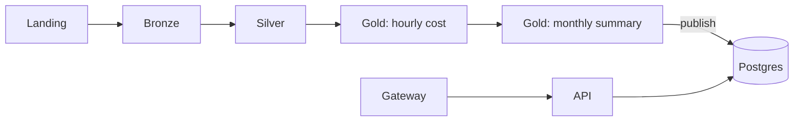

## Monthly home energy summary

Built on Databricks (free edition) with a medallion layout. Code is SQL and PySpark notebooks under `notebooks/`. Data findings are written as comments in table creation.

### Pipeline

| Layer | Table | Grain | Status |
|---|---|---|---|
| Landing | Volume, one folder per source | Files as received | Built |
| Bronze | `meter_readings`, `spot_prices`, `homes`, `subscriptions` | As delivered, all strings | Built |
| Silver | `homes` | Home × price area period | Built |
| Silver | `meter_readings` | Home × local hour, latest version | Built |
| Silver | `spot_prices` | Price area × UTC hour | Built |
| Silver | `subscriptions` | Subscription | Built |
| Gold | `hourly_cost` | Home × local hour | Built |
| Gold | `monthly_summary` | Home × local month | Not built |
| Serving | Postgres `monthly_summary` | Home × local month | Not built |

### Not built

- **`gold.monthly_summary`**: aggregate `hourly_cost` per home and local calendar month.
- **Publish to Postgres**: upsert the monthly summary on (`home_id`, month) after the nightly job.
- **API service**: one primary-key lookup per request.
- **Incremental loads**: everything is a full rebuild. In production, ingest only new data and merge on keys. The ingestion method depends on how the sources deliver.
### API contract

`GET /v1/homes/{home_id}/monthly-summaries/{month}`, with `month` as `YYYY-MM` in the home's local calendar.

| Field | Type | Meaning |
|---|---|---|
| `home_id` | string | |
| `month` | string, `YYYY-MM` | Local calendar month |
| `currency` | string | SEK or NOK |
| `consumption_kwh` | decimal | Total consumption for the month |
| `priced_kwh` | decimal | The part of the consumption that was under a Tibber subscription. `energy_cost` is based on this |
| `energy_cost` | decimal | kWh × price, excluding the fee |
| `monthly_fee` | decimal | Monthly fee |
| `total_cost` | decimal | Energy cost plus fee |
| `price_vs_area_average_pct` | decimal, nullable | Percent difference between the home's average price per kWh and the average spot price in its area that month. Negative is cheaper |
| `evaluation` | enum: `good`, `bad`; nullable | `good` when the home paid less than the area average |
| `revision` | integer | Increases when the month's figures change |
| `computed_at` | string, ISO 8601 UTC | When the figures were last computed |

**The signal.** Within an area the hourly price is the same for everyone, so a home pays less than the area average only by using power in cheap hours. Independent of season and home size. Null for fixed tariffs.

**Versioning.** Two separate things:

- **Contract version** (`v1` in the URL): what fields exist and what they mean. New fields can be added without a new version. Anything that could break the gateway (a field renamed, removed, or changed in meaning or unit) gets a new version, and the old one keeps running until the gateway has switched.
- **Data revision** (`revision` in the response): how many times a month's figures have been recomputed. It increases when a correction changes the numbers.

**No data yet.** `404` with code `summary_not_found`, whether the home is new, the month is still running, or it isn't computed yet.

**Responsibility.**

| This service | Gateway |
|---|---|
| Correct numbers, units and month definition | Customer session and authentication |
| The good/bad evaluation | Which homes a customer owns, and calling once per home |
| Fast single-row lookup and a clear "not found" | What to show the customer on a 404 |

**Left out of v1, to be added later.**

- **Data quality**: missing hours, hours without a subscription and corrected readings are not exposed, so a total can be understated without the customer knowing.
- **A consumption signal**: the evaluation covers price only. A comparison of total consumption, for example against the same month last year, would complete it.