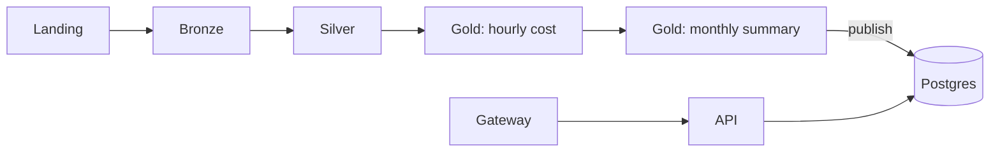

## Monthly home energy summary

Built on Databricks (free edition) with a medallion layout. Code is SQL and PySpark notebooks under `notebooks/`. Data findings are written as comments in table creation.

### Pipeline

| Layer | Table | Grain | Status |
|---|---|---|---|
| Landing | Volume, one folder per source | Files as received | Built |
| Bronze | `meter_readings`, `spot_prices`, `homes`, `subscriptions` | As delivered, all strings | Built |
| Silver | `homes` | Home × price area period | Built |
| Silver | `meter_readings` | Home × local hour, latest version | Built |
| Silver | `spot_prices` | Price area × UTC hour | Built |
| Silver | `subscriptions` | Subscription | Built |
| Gold | `hourly_cost` | Home × local hour | Built |
| Gold | `monthly_summary` | Home × local month | Not built |
| Serving | Postgres `monthly_summary` | Home × local month | Not built |

### Not built

- **`gold.monthly_summary`**: aggregate `hourly_cost` per home and local calendar month.
- **Publish to Postgres**: upsert the monthly summary on (`home_id`, month) after the nightly job.
- **API service**: one primary-key lookup per request.
- **Incremental loads**: everything is a full reload. In production, ingest only new data and merge on keys. The ingestion method depends on how the sources deliver, which is an open question.